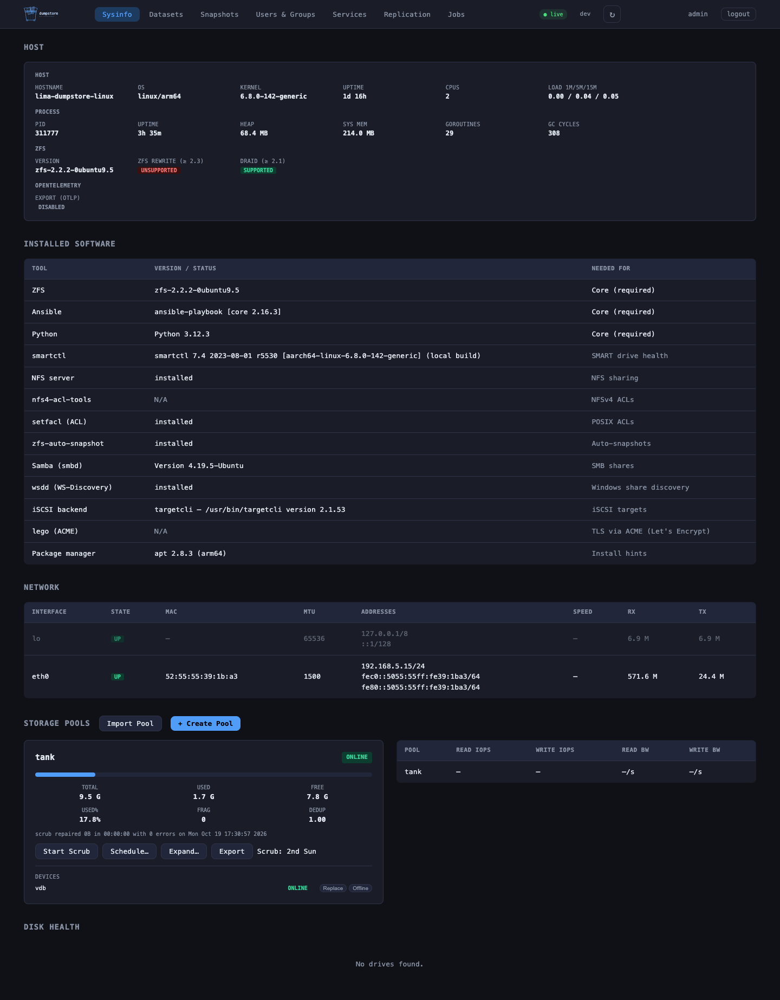
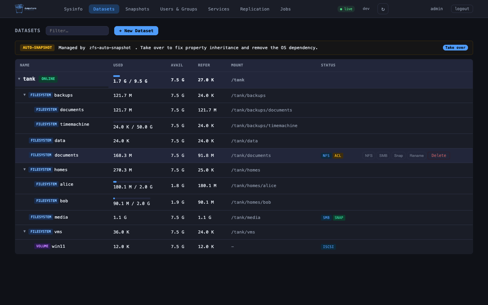
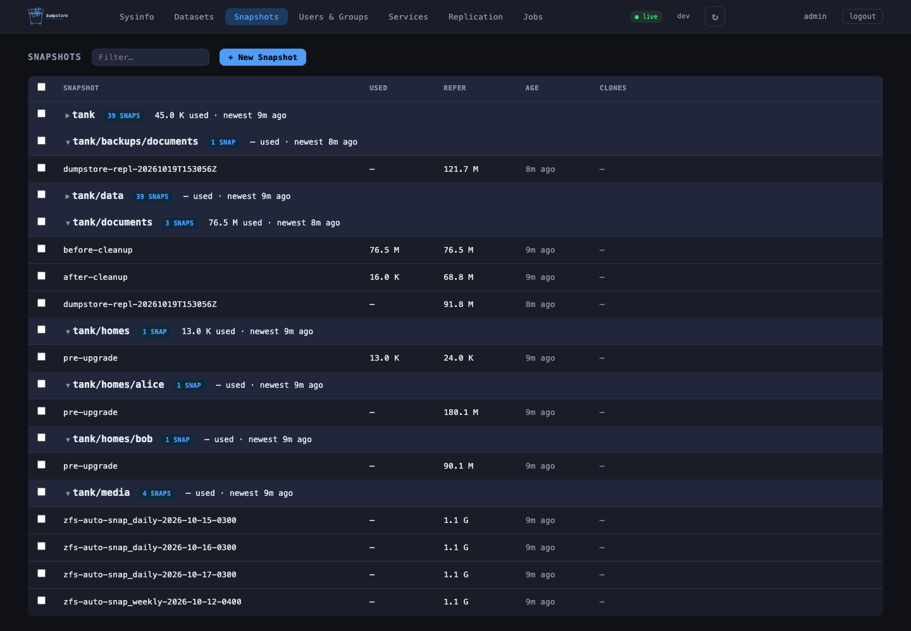
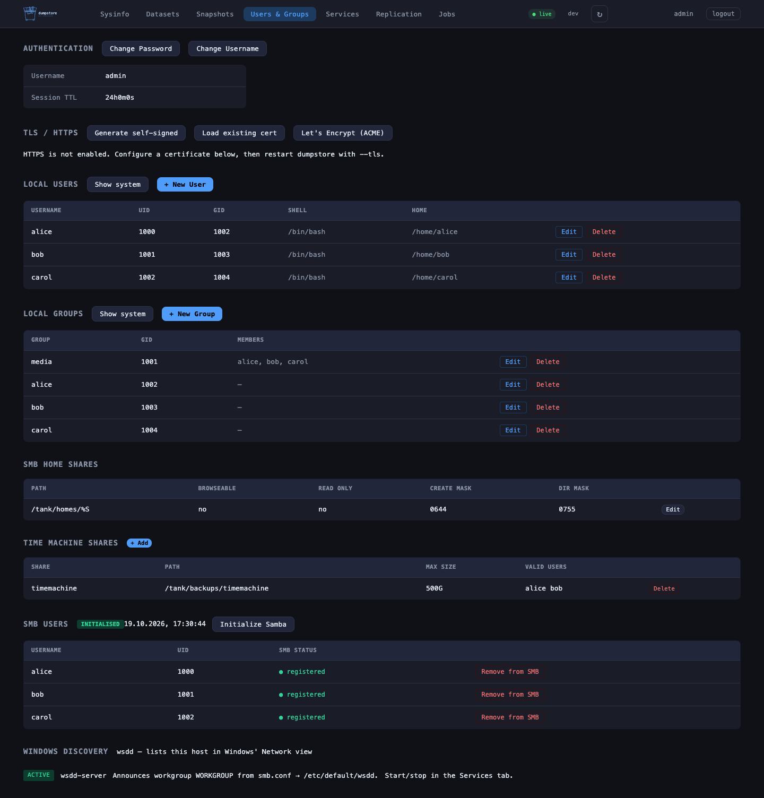
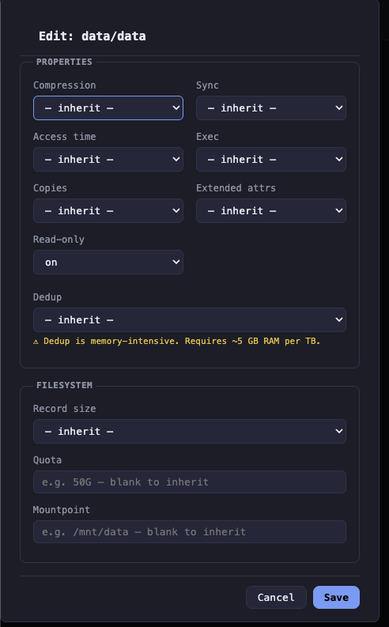
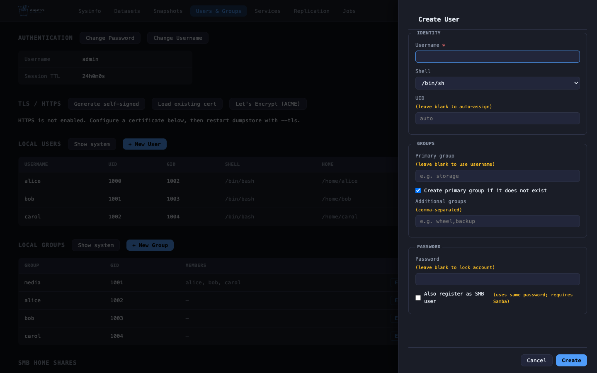
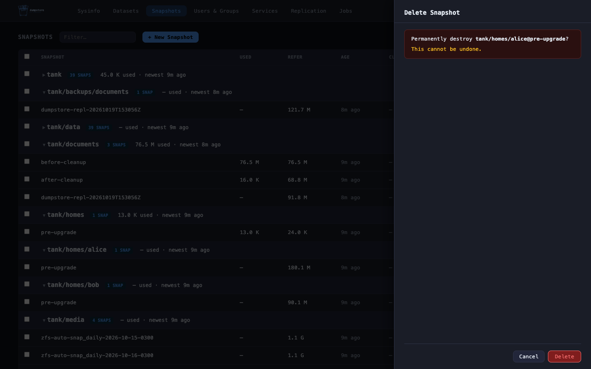
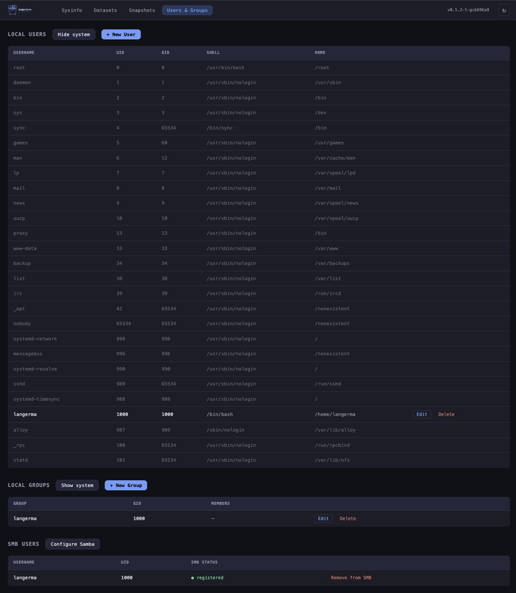

<div align="center">
  <picture>
    <source media="(prefers-color-scheme: dark)" srcset="images/dumpstore-blue-dark-lockup.svg">
    
  </picture>
</div>

<p align="center">A lightweight NAS management UI written in Go — built for Linux and FreeBSD, designed to stay out of the way of a vanilla system.</p>

> **Pre-1.0 notice:** dumpstore is under active development. Until v1.0, any release may introduce breaking changes to the API, config format, or behaviour. Use in production at your own risk.

## Why this exists

I run a [Kobol Helios64](https://wiki.kobol.io/helios64/intro/) as my home NAS — a five-bay ARM board that deserves better than the software ecosystem currently offers it. The storage UIs I tried were too heavy, too opinionated about the underlying distribution, or unmaintained. I wanted to manage my ZFS pools from a browser on a machine that stays as close to a vanilla Linux or FreeBSD install as possible: no container runtime, no database, no Node.js — a single compiled binary, some Ansible playbooks, and a handful of static files.

dumpstore **manages** ZFS and sharing — SMB, NFS, iSCSI, wsdd, and the local users and permissions they need. Where it manages a service it owns that service's config completely: the file is rendered from a template on every write, never patched. Everything else — identity servers, monitoring stacks, UPS daemons, notifications — it only **integrates** with: where a mature tool already owns a domain, dumpstore reads, displays, and links out instead of rebuilding it.

If you run a Helios64, an old server, or any ZFS box where you care about what is actually installed on it, this might be the tool for you.

## Features

**Pools & disks**
- Pool overview with health, usage, fragmentation, dedup ratio, vdev tree, live I/O statistics, and S.M.A.R.T. health per drive
- Create, import, and export pools; add data vdevs, cache, log, and spare devices
- Replace, offline, and online devices with resilver progress
- Start/cancel scrubs and configure periodic scrub schedules

**Datasets & snapshots**
- Per-pool dataset browser with a detail drawer for inline property editing, sharing, permissions, and snapshots
- Create, rename, and destroy datasets and volumes; per-user/group space usage and quotas; `zfs rewrite` as a background job
- Snapshot create, clone, diff, and (batch) delete
- Native auto-snapshot scheduling for `com.sun:auto-snapshot*`, with takeover from / release back to the OS daemon

**Replication & jobs**
- One-shot `zfs send | zfs recv` to a local pool or over SSH, incremental and `--raw`
- Cron-scheduled replication with holds, incremental selection, and retention pruning
- Long-running work runs as cancellable background jobs that survive restarts

**Sharing**
- NFS via the ZFS `sharenfs` property
- SMB usershares, Samba users, `[homes]`, and Time Machine shares — dumpstore owns `smb.conf`
- Windows network discovery via wsdd, kept in sync with Samba's workgroup
- iSCSI targets for zvols (`targetcli`/LIO on Linux, `ctld` on FreeBSD) with CHAP and initiator ACLs
- Start, stop, enable, and disable Samba, NFS, iSCSI, and wsdd from the Services tab

**Users & permissions**
- Local users (including SSH keys and Samba password sync) and groups
- POSIX and NFSv4 ACLs (NFSv4 on FreeBSD), dataset owner/group

**Operations**
- Session login with argon2id, reverse-proxy delegation (`X-Remote-User`), TLS with self-signed, existing, or ACME certificates
- Live UI updates over Server-Sent Events
- Prometheus `/metrics` and optional OpenTelemetry export (traces, logs, metrics)
- Per-request `req_id` log correlation and an audit line for every mutating operation

See [FEATURES.md](FEATURES.md) for the full list with versions, and for what is planned.

## Screenshots

<table>
<tr>
<td></td>
<td></td>
</tr>
<tr>
<td></td>
<td></td>
</tr>
<tr>
<td></td>
<td></td>
</tr>
<tr>
<td></td>
<td></td>
</tr>
</table>

## Quick start

On the NAS, as root:

```bash
git clone https://github.com/langerma/dumpstore.git
cd dumpstore
sudo ./install.sh
```

The installer installs Go and Ansible if they are missing, builds the binary, installs to `/usr/local/lib/dumpstore/`, prompts for the admin password, and registers the systemd unit or rc.d script. Open `http://<host>:8080` and log in as `admin`.

Remove it again with `sudo ./install.sh --uninstall`.

## Requirements

- **Required:** ZFS and Ansible (Python 3). dumpstore checks for `zfs`, `zpool`, and `ansible-playbook` at startup and refuses to start without them. Building needs Go 1.26+.
- **Optional, per feature:** `smartmontools`, `samba`, an NFS server, `targetcli-fb`, `acl` / `nfs4-acl-tools`, `wsdd-server`, `lego` (ACME). The System tab's Installed Software card shows which are present and which feature each one unlocks.

Per-distro package names and commands are in [Installation](https://github.com/langerma/dumpstore/wiki/Installation).

## Security

dumpstore runs as root, because ZFS requires it. If no password is configured, it binds to `127.0.0.1` only. Do not expose it on a public interface without TLS and authentication in front of it — see [SECURITY.md](SECURITY.md) for the recommended deployment.

## Documentation

The [wiki](https://github.com/langerma/dumpstore/wiki) holds the details:

- [Installation](https://github.com/langerma/dumpstore/wiki/Installation) — requirements per distro, install options, authentication and the config file, reverse proxies, service configuration, observability setup, versioning
- [Architecture](https://github.com/langerma/dumpstore/wiki/Architecture) — the read/write execution lanes, service ownership model, frontend, observability internals, project layout, testing
- [API Reference](https://github.com/langerma/dumpstore/wiki/API-Reference) — every endpoint, request/response examples, and the SSE event stream

## Development

```bash
make dev                 # run the UI against fake zfs/zpool/ansible stubs (macOS, no ZFS needed)

make vm-linux-start      # Ubuntu 24.04 VM with ZFS via Lima, port 8080 (FreeBSD 15: vm-freebsd-*, port 8081)
make vm-linux-deploy     # build and install the current tree in the VM (login admin / admin)
make test-integration    # end-to-end suite against the deployed VM

go build ./... && go vet ./... && go test ./...
```

The VMs need [Lima](https://github.com/lima-vm/lima). See [tests/integration/README.md](tests/integration/README.md) for the integration suite.

Contributions are welcome — please read [CONTRIBUTING.md](CONTRIBUTING.md) first. Bug reports and feature requests go through the [issue tracker](https://github.com/langerma/dumpstore/issues). This project follows a [Code of Conduct](CODE_OF_CONDUCT.md).
